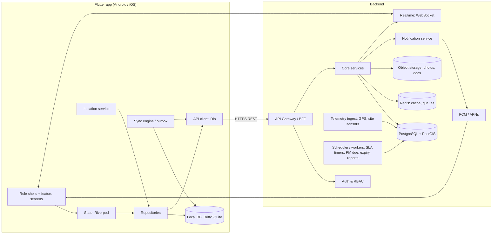
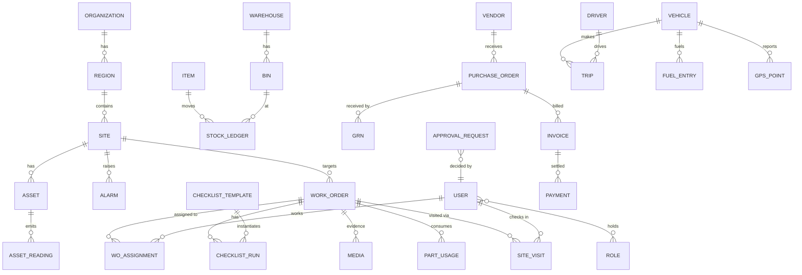
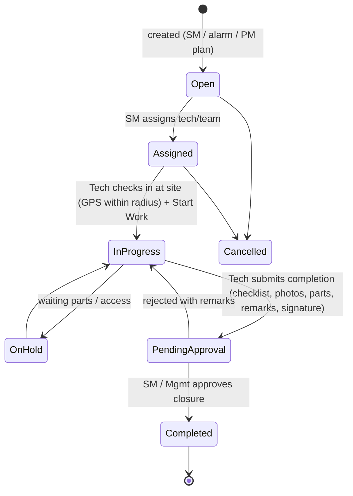

# TMS — Telecom Management System: System Design

> Status: **Draft v0.1** · Source of truth for UI: [`App_UI/`](../App_UI) (208 screens across 6 role apps)
> Client: Flutter (this repo, package `sites_n_tower`) · Region: Bangladesh (BDT, GMT+6)

---

## 1. What we're building

TMS is a single mobile app for a telecom tower company. It manages **sites/towers, work orders, field engineers, vehicles, inventory and vendors**. Users pick a role at start-up. Each role gets its own navigation shell, dashboard and feature set, and they all work on the same backend data.

| # | Role app | Primary users | Theme | Screens in `App_UI` | Core job |
|---|----------|---------------|-------|---------------------|----------|
| 0 | **Common** | Everyone | Blue | 4 (splash, role select, login, dashboard) | Onboarding & auth |
| 1 | **Management** | Head office, Super Admin, Regional Mgr | Navy | 36 | Oversight: KPIs, SLA, finance, risk, approvals, users |
| 2 | **Site Operations** | Site Manager / In-charge | Blue/Navy | 32 (05–36) | Run a set of sites: WOs, team, maintenance, fuel, checklists |
| 3 | **Field Force** | Engineer / Technician | Navy | 40 | Execute WOs on site: check-in, checklist, photos, parts, report |
| 4 | **Fleet** | Fleet Manager / Driver | Navy | 36 (41–76) | Vehicles, trips, drivers, fuel, maintenance, tracking |
| 5 | **Inventory** | Inventory Officer / Warehouse | Green | 28 | Items, GRN, stock moves, counts, POs, warehouses, bins |
| 6 | **External** | Vendor / external technician | Green | 32 | Vendor portal: POs, shipments, invoices, payments, RFQs |

### Key cross-cutting requirements (from the UI)

- **Role-based access**: role selection → login → role-specific dashboard; "Switch Role" in Fleet profile ⇒ one user may hold several roles.
- **Offline-first** for field roles: Site Manager, Field Force and Fleet all have *Offline Sync Center* screens (pending uploads, failed items, auto-sync, "Sync Now").
- **GPS**: site check-in/out with geofence radius and accuracy, live vehicle tracking, route history playback, geofence/route-deviation alerts, navigation (drive/walk/bike).
- **Media**: before/during/after photos, receipts, documents (PDF/XLSX/DOCX), signatures, 10 MB/image limits.
- **Real-time alerts**: Critical / Warning / Info tiers, push notifications, per-category toggles, quiet hours.
- **Approvals & escalations**: material requisitions, WO closure, vendor invoices, fuel expense verification, petty cash, stock adjustments, damage/returns.
- **Analytics**: nearly every module has KPI tiles, trend lines, donuts, date-range filters and downloadable reports.
- **Scanning**: barcode/QR for items (Inventory) and vehicles (Fleet vehicle details has a QR).
- **i18n**: Language setting (English; Bangla expected), units (metric), date format, theme (light/system).

---

## 2. Architecture overview



### 2.1 Client (this repo)

One Flutter codebase, **one app binary**, with six role shells. Reasons:
- The splash and role-selection screens present TMS as a single app with personas.
- Entities (site, WO, item, vehicle, vendor) are shared across roles; one data layer avoids duplication.
- Role switching is an explicit feature.

(If the vendor portal later needs a separate store listing or white-labelling, `External` can be split into its own flavor with no architecture change; see §7.)

### 2.2 Backend (recommendation — not yet decided)

The UI implies a relational, transactional domain (stock ledgers, POs, invoices, approvals) plus geospatial queries. Recommended:

| Concern | Recommendation | Why |
|---|---|---|
| API | REST (JSON) behind a BFF, OpenAPI spec | Simple for mobile, codegen for Dart client |
| DB | PostgreSQL + PostGIS | Ledgers/joins, geofences, distance queries |
| Realtime | WebSocket channel (alerts, live vehicles, chat) | Live tracking + alert feed |
| Push | Firebase Cloud Messaging | Android + iOS |
| Files | S3-compatible object storage, pre-signed uploads | Photos/documents from offline queue |
| Jobs | Queue + scheduler (e.g. BullMQ / Celery) | SLA timers, PM due, doc expiry, report generation |
| Auth | JWT access + refresh, OTP via SMS, optional SSO | Login screens show email/phone, OTP, Google/Microsoft/Apple |

A BaaS (Supabase/Firebase) is a viable shortcut for an MVP. PostgreSQL-based Supabase fits the relational model better than Firestore.

---

## 3. Flutter client design

### 3.1 Packages

| Area | Package |
|---|---|
| State / DI | `flutter_riverpod`, `riverpod_annotation` |
| Routing | `go_router` (nested `StatefulShellRoute` per role for bottom nav) |
| Networking | `dio` + interceptors (auth refresh, retry, logging) |
| Models | `freezed`, `json_serializable` |
| Local DB | `drift` (SQLite) — offline cache + outbox |
| Secure storage | `flutter_secure_storage` (tokens) |
| Background sync | `workmanager` + `connectivity_plus` |
| Maps / location | `google_maps_flutter`, `geolocator`, `flutter_background_geolocation` (drivers) |
| Charts | `fl_chart` |
| Camera / files | `image_picker`, `camera`, `file_picker`, `flutter_image_compress` |
| Scanning | `mobile_scanner` |
| Push | `firebase_messaging`, `flutter_local_notifications` |
| Docs | `open_filex`, `pdf`/`printing` (report export), `share_plus` |
| Signature | `signature` |
| i18n | `flutter_localizations`, `intl` (en, bn) |

### 3.2 Folder structure (feature-first)

```
lib/
  main.dart
  app/
    app.dart                 # MaterialApp.router, theme, locale
    router/                  # go_router config, role guards
    theme/                   # tokens, blue (ops) + green (supply) palettes
    shells/                  # one bottom-nav shell per role
  core/
    network/                 # dio client, interceptors, api exceptions
    db/                      # drift database, DAOs
    sync/                    # outbox, sync worker, conflict policy
    auth/                    # session, token storage, rbac
    location/                # gps, geofence checks
    media/                   # capture, compress, upload queue
    notifications/           # fcm, local notifications, alert model
    widgets/                 # shared UI kit (see 3.4)
    utils/                   # formatters (BDT, dates), validators
  features/
    onboarding/              # splash, role select, login, OTP, forgot password
    dashboard/               # per-role dashboards
    sites/                   # list, overview, health, equipment, generator, map
    work_orders/             # list, details, create/assign, checklist, completion, report
    checklists/              # templates, safety, inspection
    attendance/              # check-in/out, time tracking, team attendance
    maintenance/             # schedules (site + vehicle), service history
    fuel/                    # site generator fuel + vehicle fuel
    inventory/               # items, GRN, adjust, transfer, count, reorder, bins, BOM
    procurement/             # PO, RFQ, suppliers, requisitions
    fleet/                   # vehicles, drivers, trips, tracking, geofence, docs
    incidents/               # incidents, alarms, escalations, roadside assistance
    approvals/               # unified approval inbox
    finance/                 # budget, expenses, petty cash, invoices, payments, ledger
    vendors/                 # vendor portal + vendor management
    documents/               # document center
    communication/           # chat, announcements, team directory
    analytics/               # KPI, reports, strategic, decision support
    admin/                   # users & roles, settings, configuration
    profile/                 # profile, certifications, settings, help
```

Each feature follows `data/` (DTOs, remote + local sources, repository impl) → `domain/` (entities, repository interface) → `presentation/` (screens, widgets, controllers).

### 3.3 Navigation per role (bottom nav from the mockups)

| Role | Tab 1 | Tab 2 | Tab 3 | Tab 4 | Tab 5 |
|---|---|---|---|---|---|
| Management | Dashboard | Sites | Work Orders | Reports | More |
| Site Manager | Dashboard | Sites | Work Orders | Alerts / Team / Schedule* | More |
| Field Force | Dashboard | Work Orders | Checklists | Inventory | More |
| Fleet | Dashboard | Vehicles | Trips | Alerts | More |
| Inventory | Dashboard | Inventory | Receive | Orders | More |
| External | Dashboard | Orders | Shipments | Invoices | More |

\* The mockups vary tab 4 for Site Manager (Alerts, Team, Schedule, Inventory, Fuel, Checklists, Gallery). **Decision needed**: fix one tab 4 and move the rest under "More".

### 3.4 Shared UI kit (built once, reused ~200 screens)

From the mockups, almost every screen is a composition of:
- `StatTile` (label, value, delta ↑/↓ %, icon, colour) and `StatRow` (2–5 tiles)
- `StatusChip` (Active, Pending, In Progress, Completed, Overdue, Critical…; one colour map)
- `PriorityChip` (Low/Medium/High/Critical/Urgent)
- `FilterTabs` with counts ("All (24) · Active (18) …"), `SearchBarWithFilter`
- `DateRangePicker` pill ("This Month · 1 May – 31 May 2024")
- `EntityCard` (thumbnail, title, subtitle, key-value rows, trailing chip, chevron)
- `KeyValueList`, `SectionHeader` ("Title … View All")
- Charts: `TrendLineChart`, `DonutWithLegend`, `ProgressBarList`, `GaugeChart`, `RiskMatrix`
- `ChecklistItemTile` (OK / Attention / Pending / Not compliant + photo button)
- `PhotoGrid` + `UploadDropzone`, `AttachmentStrip` (Photos n / Checklist n / Documents n)
- `Timeline` (visit history, trip stops, service history)
- `QuantityStepper`, `PrimaryButton` / `OutlineButton` / `DangerButton`
- `OfflineBanner` + `SyncSummaryCard`
- `MapCard` (pin, radius circle, "you are here")

### 3.5 Theming

Two palettes over one token set:
- **Ops (blue/navy)**: Common, Management, Site Manager, Field Force, Fleet. Primary `#1A3FE0`-ish, app bar navy `#0B1A5C`-ish.
- **Supply (green)**: Inventory, External. Primary `#1B6B35`-ish.
- Semantic colours shared by both: success green, warning amber, danger red, info blue.

`ThemeExtension<TmsColors>` holds status/priority colours so chips look the same everywhere. Supports light and dark themes ("Theme: System default" in settings).

---

## 4. Domain model

### 4.1 Core entities



### 4.2 Entity catalogue

| Domain | Entities | Notable fields (from UI) |
|---|---|---|
| **Org & identity** | Organization, Region, Department, User, Role, Permission, UserRole | employee ID (ENG-2024-0156), phone, email, avatar, region, on-duty status, 2FA |
| **Sites** | Site, SiteType (2G/3G/4G BTS), Asset/Equipment (BTS, BBU, RRU, antenna, MW, power, generator, battery, AC, rectifier) | Site ID (ST-1001), lat/long, geofence radius, status (Active/Maintenance/Inactive), uptime %, health %, compliance status |
| **Telemetry** | AssetReading, Alarm | power %, generator %, battery %, temperature, fuel level, coolant temp, voltage, runtime; alarm severity (Critical/Major/Minor) |
| **Work** | WorkOrder, WOType, WOAssignment, WOStatusHistory, Note, FollowUp | WO-2024-1189, type (Preventive/Corrective/Emergency/Audit), priority, due, SLA deadline, created by, assigned team |
| **Field execution** | SiteVisit (check-in/out), ChecklistTemplate, ChecklistRun, ChecklistItemResult, Media, Signature, WorkReport, Feedback | check-in GPS + accuracy, duration, distance, item status OK/Attention/Pending, photos by phase (before/during/after) |
| **Maintenance** | MaintenancePlan (PM schedule), MaintenanceTask, ServiceRecord | planned/overdue/upcoming, next due by date or runtime hours |
| **Site fuel** | FuelTank, FuelTransaction (refill/consumption/reading) | tank capacity, current level, daily consumption, est. days remaining |
| **People ops** | Attendance, Shift, Leave, Handover, TimeEntry (work/break) | check-in/out times, net working time, handover summary (site condition, open WOs, issues) |
| **Incidents** | Incident, Escalation, Issue | type (safety hazard, equipment fault, accident), escalated by/to, resolution |
| **Inventory** | Item, Category, UOM, Warehouse, Bin, Batch/Lot, StockLedger, StockAdjustment, StockTransfer, StockCount, Requisition, ReorderRule, DamageReturn, BOM | ITM-0001, min/reorder level, batch expiry, valuation (FIFO/Average), bin grid (A-01 …) |
| **Procurement** | Supplier/Vendor, PurchaseOrder, POLine, GRN, GRNLine, RFQ, Quotation, Contract/PriceAgreement | PO-2024-0158, statuses Pending/Partial/Completed, GRN ordered vs received |
| **Vendor portal** | Shipment, Invoice, Payment, Statement, Ticket, RMA, Dispute, VendorDocument, Certification, Evaluation, RiskAssessment, Onboarding | aging buckets 0–30/31–60/61–90/90+, scorecard (quality, delivery, price, communication, compliance) |
| **Fleet** | Vehicle, VehicleDocument, Driver, DriverDocument, Trip, TripCheckpoint, GPSPoint, Geofence, FuelEntry, VehicleInspection, MaintenanceRequest, ServiceRecord, RoadsideRequest | reg no. (Dhaka Metro-TA-11-9988), odometer, insurance/fitness/tax-token expiry, trip type, cargo, weight |
| **Finance** | Budget, BudgetLine, Expense, PettyCash, CostCenter | FY (Apr–Mar), committed/available/variance, receipts |
| **Governance** | Audit, ComplianceCheck, Risk, ChangeRequest, Project, Initiative, Stakeholder, SLA, SLABreach | risk score = impact × likelihood, change success rate |
| **Comms** | Notification, Announcement, Event, ChatThread, Message, Document, DocumentFolder | severity, read state, categories (Policy/SOP/Reports/Contracts) |
| **Platform** | ApprovalRequest (polymorphic), AuditLog, Attachment, SyncOutbox | `subject_type`/`subject_id`, approver chain, state |

### 4.3 ID conventions

Human-readable document numbers, generated server-side: `WO-YYYY-NNNN`, `INC-`, `PO-`, `GRN-`, `REQ-`, `STR-`, `ADJ-`, `CNT-`, `TRIP-`, `INV-`, `PAY-`, `RFQ-`, `RMA-`, `CON-`, `DSP-`, `TKT-`, `AUD-`. Database primary keys stay UUIDs, so clients can create records offline.

---

## 5. Key workflows

### 5.1 Work order lifecycle (Site Manager ↔ Field Force ↔ Management)



Rules:
- **Start Work** requires an active SiteVisit (check-in inside the geofence) and a completed **Pre-work Safety Checklist** (Field Force #23).
- **Parts used** create `ISSUE` entries in the StockLedger against the site or warehouse.
- An **SLA timer** starts at `Open` using the WO priority. Workers raise *SLA Breach Warning* before the deadline and escalate at breach.
- *Create Follow-up WO* links the new WO to its parent.

### 5.2 Site check-in / check-out

1. The app gets a GPS fix and shows its accuracy (e.g. 8.5 m).
2. It checks the distance to the site against the site's geofence radius on the client (and again on the server).
3. It creates a `SiteVisit{checkInAt, lat, lng, accuracy, userId, woId?}`. This works offline via the outbox.
4. Check-out closes the visit and computes duration and distance. The visit feeds Visit History, Attendance and Time Tracking.
5. Anti-spoofing: reject mock locations (`isMocked`), and flag the visit when accuracy is worse than a threshold.

### 5.3 Spare parts: request → issue → consume

Field Force *Spare Parts Request* (issue from site stock **or** request from warehouse) → Site Manager approval → Inventory *Requisition* / *Stock Transfer* → dispatched → received at site → consumed on WO (*Material / Parts Used*). Every step writes to the **StockLedger**. That ledger is the only source of truth for quantities; stock levels are computed from it.

### 5.4 Procure-to-pay (Inventory ↔ External ↔ Management)

Reorder suggestion → Requisition → (RFQ → Quotations → select) → **PO** → Vendor confirms (External) → **Shipment** → **GRN** (partial/complete) → **Invoice** (3-way match: PO / GRN / invoice) → approval (Management *Approval & Escalation*) → **Payment** → Vendor ledger / statement / aging.

### 5.5 Fleet trip

Assign vehicle + driver → **Trip Start** (odometer, fuel, pre-trip checklist mandatory) → live GPS stream (background) → geofence/route deviation alerts → **Trip Complete** (end odometer, fuel consumed, auto summary: distance, duration, avg speed). Fuel entries with receipts go to **Fuel Expense Verification** before accounting.

### 5.6 Approvals (unified)

A single `ApprovalRequest` model covers: material requisition, WO closure, vendor invoice, fuel expense, petty cash, stock adjustment, damage/return, change request, vendor onboarding, handover. Each type has a configurable approver chain (Inventory Settings → *Approval Workflows*). Management sees one inbox with tabs Pending / Escalated / Approved / Rejected.

### 5.7 Alerts & escalation

Sources: site telemetry thresholds, SLA timers, stock thresholds, document/certificate expiry, geofence events, PM due, and manual escalations.
Pipeline: event → rule engine → `Notification` (severity, target users by role/site/region) → WebSocket + FCM → auto-escalate if not acknowledged within N minutes.

---

## 6. Offline-first & sync

Applies to **Field Force, Site Manager, Fleet** (the three apps with sync screens).

- **Read model**: Drift caches the data the user is scoped to (assigned sites, their WOs, checklists templates, item catalogue, their vehicles/trips).
- **Write model: outbox pattern**. Each mutation is written locally first and appended to `sync_outbox(id, entity, op, payload, created_at, attempts, status, size_bytes)`. The UI updates at once.
- **Media**: stored locally, compressed (JPEG ≤ 10 MB), and uploaded separately via pre-signed URLs. The owning record is marked synced only when all its media are uploaded.
- **Triggers**: connectivity regained, app foreground, periodic `workmanager` job, manual "Sync Now". The "Auto Sync" toggle is exposed in settings.
- **Ordering**: strict per-entity ordering (e.g. check-in before WO start before completion). Other entities sync in parallel.
- **Conflicts**: server-authoritative on status transitions (the server validates the state machine). Field data (notes, readings) is last-writer-wins, with both versions kept in AuditLog. Failed items appear under "Failed Items" with a retry button.
- **Idempotency**: the client sends `Idempotency-Key = outbox.id`, so retries never duplicate records.

---

## 7. Security & access control

- **AuthN**: phone/email + password, SMS OTP login (Field Force), optional SSO (Google / Microsoft / Apple). Accounts are admin-created ("Don't have an account? Contact Admin"), with no self-signup except vendor registration.
- **Tokens**: short-lived JWT access token plus a rotating refresh token in `flutter_secure_storage`. Optional 2FA (Settings).
- **AuthZ: RBAC with data scoping**:
  - *Role* → set of permissions (`work_order.assign`, `inventory.adjust`, `approval.decide:invoice`…).
  - *Scope* → which rows a user sees: org-wide (Super Admin), region (Regional Manager), sites (Site Manager), assigned WOs (Technician), own vehicle/trips (Driver), own vendor account (External).
  - The server enforces both; the client only hides UI.
- **Vendor isolation**: External users only ever see records where `vendor_id = their vendor`.
- **Audit log** on every state change and approval.
- **Device**: block rooted or mock-location devices for check-in (warn only in MVP). Offline data is encrypted at rest (SQLCipher via `drift` + `sqlcipher_flutter_libs`).

### Suggested roles (seed data)

`super_admin`, `regional_manager`, `finance`, `procurement`, `site_manager`, `site_incharge`, `field_engineer`, `technician`, `fleet_manager`, `driver`, `inventory_officer`, `warehouse_manager`, `vendor_admin`, `vendor_user`.

---

## 8. API surface (first cut)

REST, versioned `/api/v1`, cursor pagination, `?status=&from=&to=&region=&site=` filters that match the filter tabs.

| Resource | Endpoints (examples) |
|---|---|
| Auth | `POST /auth/login`, `/auth/otp/request`, `/auth/otp/verify`, `/auth/refresh`, `/auth/logout`, `GET /me` (roles, scopes) |
| Dashboards | `GET /dashboards/{role}?period=` (server-aggregated KPI tiles) |
| Sites | `GET /sites`, `GET /sites/{id}`, `/sites/{id}/health`, `/sites/{id}/assets`, `/sites/{id}/fuel`, `/sites/map?bbox=` |
| Work orders | `GET/POST /work-orders`, `PATCH /work-orders/{id}`, `POST /work-orders/{id}/transitions` `{action}`, `/checklists`, `/media`, `/parts`, `/notes`, `/report` |
| Visits | `POST /site-visits` (check-in), `POST /site-visits/{id}/checkout` |
| Attendance | `POST /attendance/clock`, `GET /attendance?date=`, `POST /handovers` |
| Inventory | `/items`, `/warehouses`, `/bins`, `/stock?item=&warehouse=`, `/stock-ledger`, `/grns`, `/adjustments`, `/transfers`, `/counts`, `/requisitions`, `/reorder-suggestions`, `/boms` |
| Procurement | `/purchase-orders`, `/rfqs`, `/quotations`, `/suppliers`, `/contracts` |
| Vendor portal | `/vendor/me`, `/vendor/orders`, `/vendor/shipments`, `/vendor/invoices`, `/vendor/payments`, `/vendor/statements`, `/vendor/tickets`, `/vendor/rmas`, `/vendor/documents` |
| Fleet | `/vehicles`, `/drivers`, `/trips`, `/trips/{id}/start`, `/trips/{id}/complete`, `/vehicles/{id}/track`, `/geofences`, `/fuel-entries`, `/vehicle-inspections`, `/roadside-requests` |
| Approvals | `GET /approvals?state=`, `POST /approvals/{id}/decision` |
| Alerts | `GET /notifications`, `POST /notifications/{id}/ack`, `PUT /notification-preferences` |
| Media | `POST /uploads/presign`, `POST /attachments` |
| Sync | `POST /sync/batch` (outbox flush), `GET /sync/changes?since=` (delta pull) |
| Analytics | `GET /reports/{key}?period=&format=pdf|xlsx` |
| Realtime | `wss://…/rt` channels: `alerts.{userId}`, `fleet.live`, `chat.{threadId}` |

---

## 9. Non-functional targets

| Area | Target |
|---|---|
| Scale (from mockup numbers) | ~1,250 sites, ~250 engineers, ~150–350 vehicles, ~2,500 items, ~150 vendors, ~350 WOs/month |
| GPS | Driver ping every 15–30 s while on trip (adaptive); site check-in accuracy ≤ 50 m |
| Offline | Field users work a full day offline; queue ≥ 500 records + ≥ 200 photos |
| Performance | Cold start < 3 s on mid-range Android; lists paginated (20–50) |
| Availability | 99.5% API; alerts delivered < 60 s |
| Localization | English + Bangla; BDT (৳) formatting with lakh/crore grouping option; GMT+6 |
| Min OS | Android 8+ (API 26), iOS 15+ |

---

## 10. Issues found in the mockups (need decisions)

1. **The External app mixes two audiences.** Screens 1–12 and 14 are a *vendor-facing* portal ("Welcome, Fiber Tech Solutions Ltd.", my invoices). Screens 13 and 15–32 (Vendor Onboarding, Compliance, Risk Assessment, Disputes, Registration, Sourcing/RFQ, Vendor Audit, Vendor Analytics across many vendors) are *buyer-side vendor management*.
   **Proposal:** vendor-facing → External role; vendor management → a *Procurement* section under Management (or Inventory).
2. **Duplicates in Inventory**: Dashboard (#1 vs #28), Item Master (#2 vs #26), stock count (#7 Physical Count, #17 Stock Take, #27 Stock Audit), GRN (#3 vs #22). Merge into one screen each, with tabs.
3. **Duplicates in Management**: Alerts (#4, #16, #30), Financial Overview (#11, #25), KPI (#2, #31). Merge them.
4. **Site Manager's two visual styles**: screens 05–20 use a bright-blue header, 21–36 a navy header with a site switcher ("Site-CTG-01 ▾"). Pick one. The **site switcher** is a good pattern to keep.
5. **Login differences**: Common login offers email/phone + Google/Microsoft/Apple; Field Force offers mobile + password + OTP. Decide per role whether social login is allowed (enterprise users usually get SSO only).
6. **Tab 4 of Site Manager's bottom nav** changes from screen to screen (see §3.3).
7. **Screen counts**: the scope is ~208 screens. The roadmap below gets a usable product much sooner.

---

## 11. Delivery roadmap

| Phase | Scope | Outcome |
|---|---|---|
| **0. Foundations** (1–2 wks) | Theme + UI kit (§3.4), router with role shells, auth (login/OTP, token refresh), Drift setup, API client, mock backend/fixtures | Clickable shell for all 6 roles |
| **1. Field MVP** (4–6 wks) | Sites (list/overview), Work Orders end-to-end (§5.1), GPS check-in/out, checklists, photos, parts used, completion report, offline outbox, push alerts | Technicians and Site Managers can run real WOs |
| **2. Inventory core** (3–4 wks) | Items, warehouses/bins, StockLedger, GRN, issue/transfer/adjust, requisitions, low-stock alerts, barcode scan | Parts flow connects to WOs |
| **3. Fleet** (3–4 wks) | Vehicles, drivers, trips start/complete, background tracking, live map, fuel entries + verification, docs expiry | Fleet operations live |
| **4. Management** (3–4 wks) | Role dashboards, KPI/SLA, approvals inbox, users & roles, reports export, site health map | Head office visibility |
| **5. Vendor portal** (3 wks) | POs, shipments, invoices, payments, statements, tickets, documents | Vendors onboarded |
| **6. Advanced** | Budget/finance, risk, change mgmt, capacity planning, sustainability, decision support, chat, projects | Full mockup coverage |

### Immediate next steps

1. Agree on the backend choice (§2.2) and the mockup decisions (§10).
2. Add packages (§3.1) and scaffold the `lib/` structure (§3.2).
3. Build the design tokens and UI kit, then the onboarding flow (splash → role → login → dashboard) against mock data.

